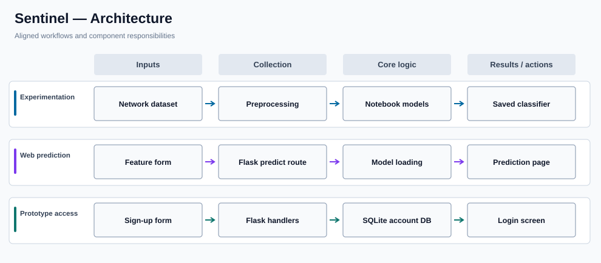

# Sentinel

**Educational network intrusion classification interface**

## Overview

Sentinel is an educational network-intrusion classification project combining notebook-based machine-learning exploration with a Flask web interface. The application accepts structured network features, loads a saved classifier, and displays a prediction. Its notebook experiments explore preprocessing and machine-learning techniques for intrusion-oriented datasets.

### Why it matters

Security classification models need to connect feature preparation and inference with an interface that can be understood and examined. Sentinel demonstrates that workflow while retaining a clear distinction between classroom experimentation and operational intrusion detection.

## Key capabilities

- Explores structured network traffic features in Jupyter notebooks.
- Uses scikit-learn for preprocessing and classifier experimentation.
- Provides Flask routes for navigation, sign-up, and sign-in screens.
- Accepts feature inputs through a prediction form.
- Loads an expected serialized classification model for inference.
- Uses SQLite for the prototype's account-related web flow.

## System architecture



### How the workflow operates

Notebook experiments support the model development path. The Flask app provides user-facing pages and a `/predict` route that converts submitted form values into a model input. The route loads a serialized classifier and returns its label for rendering.

Authentication and email functionality exist in the prototype but are not suitable for a public deployment in their current form. Keep the repository as a learning example until those issues are corrected.

## Technology stack

| Technology | Purpose |
| --- | --- |
| **Python / pandas / NumPy** | Feature preparation and tabular data |
| **scikit-learn / joblib** | Classifier experimentation and loading |
| **Flask / HTML** | Web application and form handling |
| **SQLite** | Prototype account storage |
| **Jupyter** | Model experimentation notebooks |

## Repository structure

```text
app.py            Flask routes, prediction, and prototype login
Notebook.ipynb    Machine-learning experiments
templates/        HTML screens
static/           Frontend assets
flowchart.txt     Prior project flow notes
README.md         Project documentation
```

## Getting started

```bash
python3 -m venv .venv
source .venv/bin/activate
pip install flask numpy pandas scikit-learn joblib
# Provide a compatible model_emb.sav in an isolated environment.
python app.py
```

## Notes and prerequisites

**Security caution:** The existing code contains a credential-like SMTP value and uses weak prototype account handling, and a populated `signup.db` is committed. Do not deploy or publicly test the authentication workflow. Complete the separate security remediation, rotate affected credentials, and use synthetic accounts. A saved model is also required for prediction.
