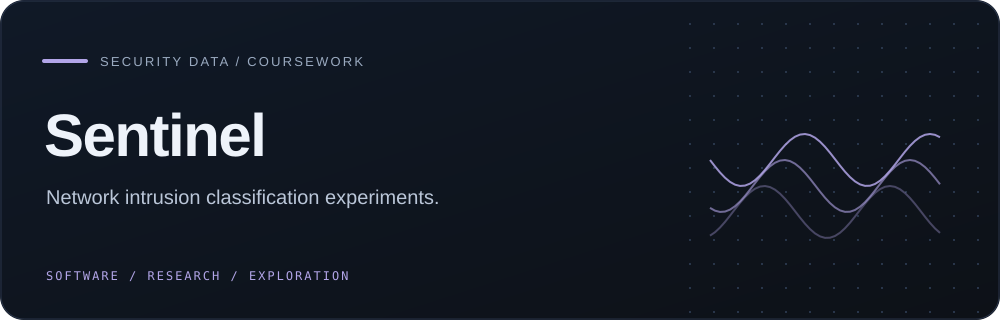
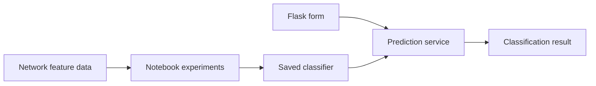

   

<strong>An educational intrusion-classification project combining notebook experiments with a Flask prediction interface.</strong>

## Overview

An educational intrusion-classification project combining notebook experiments with a Flask prediction interface.

### Why it matters

Sentinel connects the full shape of an applied ML security project: feature preparation, classifier experiments, saved artifacts, and a web-facing prediction flow.

## Key features

- UNSW-NB15-style feature exploration
- Multiple scikit-learn classifier experiments
- Feature-selection and resampling workflows
- Flask interface for model-backed predictions

## Architecture

## Technology stack

**python** · **flask** · **scikit learn** · **sqlite**

## Getting started

Provide a permitted dataset and compatible saved model, install the imported Python packages, and use only synthetic accounts in a local environment. Keep credential remediation in the separate security PR.
